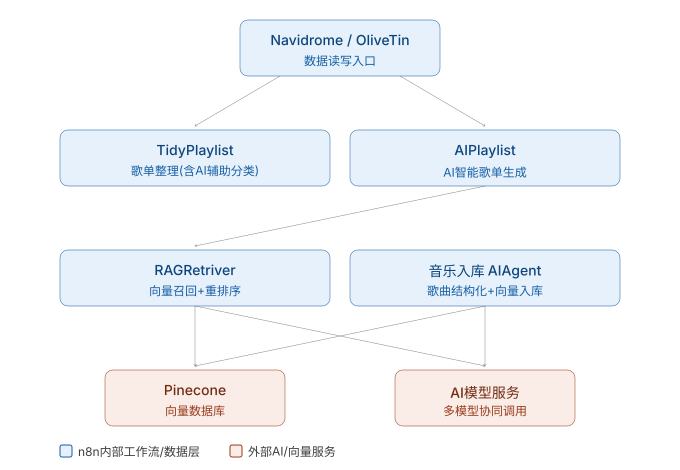

<h1 align="center">🎵 GYMDL</h1>
<p align="center">跨平台智能音乐下载与管理工具</p>

<p align="center">
    <a href="#"></a>
    <a href="#"></a>
    <a href="https://github.com/nichuanfang/gymdl/releases"></a>
    <a href="https://github.com/nichuanfang/gymdl/pkgs/container/gymdl"></a>
    <a href="#"></a>
</p>

---

## 🧭 项目简介

**GYMDL** 是一款跨平台智能音乐下载与管理工具，基于 Go 开发，支持自动识别主流音乐平台链接，并实现高效下载、解密与整理。同时提供
CookieCloud 自动同步登录、WebDAV 上传、目录监控、Telegram Bot 控制与通知，以及内置 WebUI（下载 / 搜索 / 历史 / 文件库 / 日志 / 设置 / QQ 扫码登录）等功能，让音乐管理更智能、更便捷。

- **当前版本**：[`v1.5.10`](https://github.com/nichuanfang/gymdl/releases)（多平台二进制 + Docker 镜像）
- **运行形态**：本地二进制 / Docker / NAS，均可叠加 Telegram Bot 与 WebUI

---

## ✨ 核心特性

| 功能                                                            | 状态      |
| --------------------------------------------------------------- | --------- |
| 主流音乐平台：Apple Music、Spotify、YouTube Music、SoundCloud 等 | ✅        |
| 智能链接识别与解析                                              | ✅        |
| CookieCloud 自动同步登录状态                                    | ✅        |
| WebDAV 自动上传整理后的音乐                                     | ✅        |
| Telegram Bot 控制下载、接收通知                                 | ✅        |
| 定时任务调度（gocron）                                          | ✅        |
| 目录监控 / 下载器监控                                           | ✅        |
| QQ 音乐下载                                                     | ✅        |
| 网易云音乐下载                                                  | ✅        |
| Apple Music 下载                                                | ✅        |
| YouTube Music 下载                                              | ✅        |
| SoundCloud 下载                                                 | ✅        |
| Spotify 下载                                                    | ✅        |
| AI 助手                                                         | ✅        |
| 集成 n8n                                                        | ✅        |
| Web UI（下载 / 搜索 / 历史 / 文件库 / 日志 / 设置 / QQ 登录）     | ✅        |
| 视频下载（YouTube、Bilibili、抖音等）                           | ✅        |
| 多个通知渠道                                                    | ⚠️ 规划中 |

---

## 🎧 支持的平台

### 音乐

| 平台            | 链接示例                                                        | 说明                          |
| --------------- | --------------------------------------------------------------- | ----------------------------- |
| 网易云音乐      | `music.163.com/#/song?id=...`、`163cn.tv/...`                   | 支持歌曲 / 歌单 / 专辑 / 电台 |
| QQ 音乐         | `y.qq.com/...`、`i.y.qq.com/n2/m/share/details/...`             | 需配合 QQMusicApi 使用        |
| Apple Music     | `music.apple.com/.../song/...`、`.../album/...`                 | 支持歌曲 / 专辑 / 播放列表    |
| YouTube Music   | `music.youtube.com/watch?v=...`                                 | 基于 yt-dlp                   |
| SoundCloud      | `soundcloud.com/...`、`snd.sc/...`                              | 支持曲目 / Set                |
| Spotify         | `open.spotify.com/track/...`                                    | 支持 track / album / playlist |

### 视频

| 平台     | 链接示例                            |
| -------- | ----------------------------------- |
| YouTube  | `youtube.com/watch?v=...`、`youtu.be/...` |
| Bilibili | `bilibili.com/video/BV...`、`b23.tv/...` |
| 抖音     | `douyin.com/video/...`、`v.douyin.com/...` |
| 小红书   | 站内分享链接                        |

> 💡 `additional_config.music_mode` 开启后，视频平台链接会优先转为音频下载。

---

## 🕸️ 架构图

### 五层架构

<a href="#"></a>

### n8n 架构

<a href="#"></a>

---

## 🖥️ Web UI

内置 Web UI，提供以下功能：

- **仪表盘**：各服务在线状态总览
- **下载**：粘贴链接提交下载，实时查看任务进度
- **搜索**：多平台（网易云 / QQ 等）关键词搜索，支持 10/20/50/100 条合并分页，点击下载时进行重复预检
- **历史**：查看已完成/失败的下载记录（持久化到 `data/gymdl.sqlite3`）
- **文件库**：浏览整理后的音乐文件，支持在当前目录子树按歌曲名/歌手/专辑搜索，并支持试听/删除
- **设置**：在线编辑并保存 `config.yaml` + CookieCloud 手动同步 + 容器重启
- **日志**：实时 SSE 日志流，支持级别过滤 / 暂停 / 搜索
- **QQ 登录**：浏览器内扫码登录 QQ 音乐，无需 Bot

**启用方式**：`config.yaml` 中设置 `web_config.enable: true`，访问 `http://localhost:8080`。

**开发模式**：
```bash
# 终端 1: 启动后端
go run main.go -c config.yaml

# 终端 2: 启动前端（Vite 会将 /api 代理到 8080）
cd webui && npm run dev
```

**关于认证**：WebUI 默认保持兼容模式、不要求登录。启用 `web_config.auth` 后，配置、搜索、任务、日志和文件接口均需要登录，会话有效期 12 小时；密钥值不会回显，留空保持原值，需清除时使用字段旁的“清除”操作。反向代理部署请使用 HTTPS。

**关于服务重启**：Docker 部署下，Compose 示例已启用配置页的“容器重启”按钮（`GYMDL_WEBUI_RESTART_ENABLED=true`）；按钮只在容器中显示，存在进行中的下载任务时会拒绝重启。

**关于热加载**：目前仅 `tidy.dist_dir` 和 `additional_config.music_mode` 支持热加载，并应用于保存后的新任务；运行中的任务保留启动时快照，其余配置保存后需重启服务。

### Telegram 智能体

开启 `ai.enable` 后，Bot 有两种对话方式，按聊天分别记住模式：

- 普通模式：和原来一样，发送链接直接下载；想和智能体对话时用 `/ai <内容>`，可以一直带 `/ai` 连续追问。
- AI 模式：`/mode` 切换到 AI 后，直接发文字就会进入智能体；发链接仍然优先下载，不会打断上下文。
- `/mode ai`、`/mode normal` 可直接切换；`/clear` 只清空上下文，不改变当前模式。
- AI 模式没有固定工具优先级，由模型按意图选择内置工具、本地技能或 MCP 能力。需要具体歌曲时才回查真实平台，结果里带下载/试听按钮。
- 已入库歌曲会标 `✅`；候选按钮 30 分钟后失效，重新提问即可。同一轮生成过结果后，早先几条回答的按钮仍然可用，不会因为继续聊天而失效。
- 推荐多首时按钮下方会出现「下载前 3 首 / 全部下载」，按顺序逐首处理；每首仍然走同一套元数据预检与重复确认，不会绕过查重。
- 处理过程中占位消息会显示当前阶段（检索曲目、查曲库、调用外部服务等）；单轮总时长有上限，超时会明确提示而不是一直转圈。
- 同一聊天内的消息按顺序处理，快速连发不会出现两条回答互相覆盖；不同聊天互不阻塞。

`ai.default_mode` 控制新聊天默认进入哪种模式。`ai.skills_dirs` 下每个子目录放一个 `SKILL.md` 即成为可调用技能；`ai.mcp_servers` 只有 `allowed_tools` 中列出的工具会暴露给模型。收听画像需要配置只读的 `ai.history_dsn`，不可用时自动跳过。

默认挂载 8 个音乐技能：`music-recommendation`（按场景/情绪推荐并回查真实单曲）、`music-discovery-by-artist`（按艺人/单曲找相似）、`music-library-query`（查是否已入库、曲库内容）、`music-download-failure`（判断失败环节）、`music-download-plan`（批量下载顺序与风险）、`music-playlist-curation`（主题歌单整理）、`music-lyrics-search`（查歌词/按歌词找歌）、`music-metadata-normalize`（标签规范化）。`ai.enabled_skills` 为空时不会挂载任何技能；部署、运维类技能不要放进这个白名单。

---

## ⚙️ 快速开始

### 1️⃣ 获取项目并编译

```bash
git clone https://github.com/nichuanfang/gymdl.git
cd gymdl
make release
```

> 💡 `make release` 会先编译 WebUI（`make webui`，输出到 `web/dist` 供 `go:embed`），再交叉编译各平台二进制到 `release/` 目录，并把 `config.yaml.example`、`requirements.txt` 等一起打包。仅编译后端时可先跳过 WebUI 步骤（但 WebUI 资源将不可用）。

也可以直接下载 [Releases](https://github.com/nichuanfang/gymdl/releases) 中对应平台的压缩包。

### 2️⃣ 配置文件 `config.yaml` 示例

<details>
<summary>点击展开 YAML 配置示例</summary>

```yaml
# GYMDL 配置文件
# 以下为详细配置项说明


# 运行与网络
# Web 服务配置
web_config:
  enable: false # 是否启用 web 服务
  app_domain: 'localhost' # web 服务域名
  https: false # 是否开启 HTTPS
  app_port: 8080 # web 服务监听端口
  gin_mode: 'debug' # Gin 运行模式: 可选 [debug, release, test]
  auth: # WebUI 管理登录；密码在配置文件中为明文，请限制文件权限
    enable: false # 是否启用 WebUI 登录门禁
    username: '' # 管理员用户名
    password: '' # 管理员密码；也可通过环境变量覆盖

# NAS 断网或 WebDAV 暂时不可用时，文件会先移入 `data/webdav_pending`，下载任务照常完成并显示“待上传”。服务每分钟探测一次 NAS，恢复后自动补传并删除本地副本；无需重新下载。该目录必须随 `./data` 一起持久化。

# 日志配置
log:
  mode: 1 # 日志模式: 1=标准输出, 2=日志文件, 3=标准输出+文件
  level: 2 # 日志等级: 1=debug, 2=info, 3=warn, 4=error, 5=fatal
  file: 'data/logs/run.log' # 日志文件路径

# 代理配置
proxy:
  enable: false # 是否启用代理
  scheme: '' # 代理协议: http/https/socks5
  host: '127.0.0.1' # 代理主机
  port: 10809 # 代理端口
  user: '' # 代理用户名
  pass: '' # 代理密码
  auth: false # 是否启用代理认证

# 下载与后台任务
# 附加配置
additional_config:
  enable_cron: false # 是否启用定时任务功能 只有开启此配置才会尝试同步cookie文件(重要)
  enable_monitor: false # 是否启用目录监听 开启后监听下载目录使用um cli自动解密
  monitor_dirs:
    - '' # 监听的目录,下载器监控
  music_mode: false # 是否启用音乐模式 视频平台链接优先转为音频

# 通知与外部服务
# Telegram 配置
telegram:
  enable: true # 是否启用 Telegram 通知服务
  mode: 1 # 运行模式: 1=长轮询, 2=Webhook (推荐开发用1, 生产用2)
  chat_id: '' # 机器人 chat_id
  bot_token: '' # Telegram Bot Token
  allowed_users:
    - '' # 用户白名单列表 (Telegram 用户 ID)
  webhook_url: '' # Webhook 地址 (mode=2 时必填)
  webhook_port: 9000 # Webhook 模式下监听端口

# qq音乐api配置
qq_music_api:
  enable: false #是否启用
  endpoint: '' #服务地址 如果需要proxy_url代理 必须填公网地址 否则无法访问
  proxy_url: '' #代理地址 国外服务器需要配置以绕过地区限制
  vip_level: vip #qq会员级别,可选vip或者svip,影响音质
  login_type: 0 #登录方式: 0未登录 1微信 2QQ
  refresh_key: '' #用于刷新已失效的musickey musickey1小时会过期
  refresh_token: '' #用于刷新已失效的musickey musickey1小时会过期
  access_token: '' #用于刷新已失效的musickey musickey1小时会过期
  music_id: '' #用于刷新已失效的musickey musickey1小时会过期
  str_music_id: '' #用于刷新已失效的musickey
  open_id: '' #用于刷新已失效的musickey musickey1小时会过期
  union_id: '' #用于刷新已失效的musickey musickey1小时会过期
  music_key: '' #用于刷新已失效的musickey musickey1小时会过期
  expired_at: 0 #用于刷新已失效的musickey musickey1小时会过期

# lrcapi 配置
lrc_api:
  enable: false # 是否启用lrcapi歌词服务
  lrc_api_url: '' # lrcapi服务url
  api_key: '' # 认证key
  lrc_api_host: '' # lrcapi服务主机名 需要容器名+frp访问才需要设置

# CookieCloud 配置
cookie_cloud:
  mode: 1 # cookiecloud同步模式: 1定时刷新 2webhook 默认为1 当同步模式为2时必须启用Gin Web服务
  cookiecloud_url: '' # CookieCloud 服务地址
  cookiecloud_uuid: '' # CookieCloud UUID
  cookiecloud_key: '' # CookieCloud key (多个同步端需填写同一个key，否则会解密失败)
  cookie_file_path: '' # Cookie 文件存储目录
  cookie_file: '' # Cookie 文件名
  expire_time: 180 # Cookie 文件过期时间(分钟)

# 曲库与文件整理
# 资源整理配置
tidy:
  mode: 1 # 资源整理模式: 1=整理到 dist_dir, 2=整理到 webdav_dir
  dist_dir: 'data/dist' # 当 mode=1 时使用的本地整理目录

# WebDAV 配置
webdav:
  webdav_url: '' # WebDAV 服务地址
  webdav_user: '' # WebDAV 用户名
  webdav_pass: '' # WebDAV 密码
  webdav_dir: '' # WebDAV 目标路径
  webdav_host: '' # webdav主机名 需要容器名+frp访问才需要设置

# 歌单整理服务
playlist_organizer:
  olivetin_url: '' # OliveTin地址，例如 http://olivetin:1337
  olivetin_username: '' # 可选的 OliveTin Basic Auth 用户名
  olivetin_password: '' # 可选的 OliveTin Basic Auth 密码
  navidrome_url: '' # Navidrome地址
  navidrome_username: '' # Navidrome用户名
  navidrome_password: '' # Navidrome密码
  web_app_url: '' # Nginx 上 Telegram 歌单选择页面地址，例如 https://webapp.example.com
  playlist_assist: false # 是否使用 AI 为歌单整理预选分类
  # 歌单列表保存在同目录的 config.playlists.yaml，示例见 config.playlists.example.yaml

# AI 能力
# AI 配置
ai:
  enable: false # 是否启用 AI 功能
  base_url: '' # AI 接口的 Base URL
  model: '' # 使用的 AI 模型名称
  api_key: '' # AI 服务的 API Key
  system_prompt: '' # 默认系统提示词
  default_mode: false # 私聊是否默认进入AI模式
  max_tool_rounds: 4 # 单轮对话最多工具调用轮数
  request_timeout_seconds: 90 # 单次AI请求超时(秒)
  history_window_days: 30 # 收听历史画像窗口(天)
  max_suggestions: 10 # 单次最多展示的候选数
  skills_dirs: # 本地技能目录
    - 'skills'
  enabled_skills: # 允许AI模式使用的技能白名单
    - 'music-recommendation'
    - 'music-library-query'
    - 'music-download-failure'
    - 'music-playlist-curation'
    - 'music-discovery-by-artist'
    - 'music-lyrics-search'
    - 'music-metadata-normalize'
    - 'music-download-plan'
  mcp_servers: # MCP服务列表，只暴露 allowed_tools 中的工具
    - name: ''
      url: ''
      token: ''
      allowed_tools: # 允许调用的工具名白名单
        - ''
      timeout_seconds: 20 # 单次调用超时(秒)
  history_dsn: '' # 收听历史Postgres只读DSN
  history_table: 'music_scrobble_records' # 收听历史表名

# AI 智能歌单生成
ai_playlist:
  pinecone_host: '' # Pinecone index host，例如 https://<index>.svc.<region>.pinecone.io
  pinecone_api_key: '' # Pinecone API Key
  pinecone_namespace: 'data-music' # 必须与 MusicRAG 写入的 namespace 一致
  embedding_base_url: '' # 向量模型 API 地址；留空时使用 ai.base_url
  embedding_api_key: '' # 向量模型 API Key；留空时使用 ai.api_key
  embedding_model: 'text-embedding-3-small' # 填嵌入服务返回的模型 ID；模型与 1536 维索引必须匹配
  query_model: '' # 检索意图模型；留空时使用 ai.model
  playlist_model: '' # 歌单编排模型；留空时使用 ai.model
  playlist_size: 80 # 每个歌单目标歌曲数
  candidate_count: 150 # Pinecone 最大召回数量

# n8n 数据桥接
# N8N配置
n8n_config:
  enable: false # 是否启用n8n
  n8n_base_url: '' # 自建n8n的地址
  api_key: '' # n8n Public API密钥，用于MusicRAG状态表读取、新增和清理
  music_rag_table_id: '' # n8n music_rag数据表ID
```

</details>

> ℹ️ **提示**：展开查看每个字段的详细注释说明，方便初学者直接修改配置。完整模板见仓库中的 [`config.yaml.example`](config.yaml.example)。

> 📚 **歌单配置**：歌单选项归属 `playlist_organizer`，列表从同目录的 `config.playlists.yaml` 读取，格式见 [`config.playlists.example.yaml`](config.playlists.example.yaml)。旧版位于 `n8n_config` 的歌单列表和 AI 分类设置会自动迁移；首次在 WebUI 保存设置时，旧版内联列表会迁移到该文件。修改后需重启服务。

> 🎼 **歌单整理**：`/assign_playlist` 由 gymdl 直接执行。先选一个目标歌单，再逐首预览并确认加入；AI 归档建议需要开启 `playlist_organizer.playlist_assist` 和 `ai.enable`，只在歌曲没有同歌手归档信息时调用文本模型分类，不进行联网或向量搜索。MusicRAG 仍消费 n8n `music_rag` 表；请配置 `n8n_config.n8n_base_url`、有数据表行读取/新增/删除权限的 `n8n_config.api_key` 和 `n8n_config.music_rag_table_id`。未配置时歌单仍会更新，但机器人会明确提示 MusicRAG 状态未同步；`/empty_trash` 必须配置状态表桥接后才会执行。
> 🤖 **AI 智能歌单**：`/ai_playlist` 在 gymdl 中直接调用 AI、Pinecone 和 Navidrome。文本模型复用 `ai.base_url`、`ai.api_key` 和 `ai.model`；Embedding 可单独设置 `embedding_base_url`、`embedding_api_key` 与服务返回的模型 ID。Embedding 模型、namespace 和 1536 维索引必须与 MusicRAG 入库配置一致；检索意图和歌单编排模型可通过 `query_model` / `playlist_model` 覆盖。

### 歌单与回收站流程

- **`/assign_playlist` 歌单整理**：先选一个目标歌单，gymdl 再逐首读取待整理歌曲并展示原有风格的歌曲卡片；若启用了 AI 归档建议且歌曲没有同歌手归档信息，会调用文本模型列出建议。用户每首确认后，gymdl 补加歌曲、同步 MusicRAG 状态，再展示下一首；失败时可安全重试，状态表按歌曲 ID 去重。
- **`/ai_playlist` AI 智能歌单**：读取空的 `[AI]` 歌单，将备注改写为语义检索描述，再通过 Embedding 和 Pinecone 召回候选歌曲；gymdl 检查歌曲仍在 Navidrome 曲库后，由 AI 编排歌曲并写入歌单，最后按歌曲 ID 复核结果，避免额外重读整份歌单列表。AI 编排失败时会使用规则排序兜底。生成计划先保存到 `data/gymdl.sqlite3`；部分写入或复核失败后再次运行会只补齐缺少的歌曲，并保留歌单中原有的手动曲目。若备注已变更且歌单仍有歌曲，流程会暂停旧计划，避免混入不同主题的曲目。失效 Pinecone 向量按批删除，避免逐首发起请求。
- **`/empty_trash` 清空回收站**：校验歌曲 ID 和相对文件路径，预检 MusicRAG 删除权限及 Pinecone 连通性，再展示待删数量供用户确认（5 分钟内有效）。确认时会重新读取回收站；若内容变化则停止并要求重新确认。清理顺序为 Pinecone 向量、MusicRAG 状态、歌曲文件。失败会报告阶段和文件进度；各删除操作可幂等重试，重新发送 `/empty_trash` 即可重试未完成的清理。

### 流程优化进度

已完成：清空回收站增加数量预览和确认；确认后复核回收站内容；先删 Pinecone 向量，避免向量删除失败时先清空 MusicRAG 状态；失败后可安全重跑删除流程。AI 歌单将计划持久化到 SQLite，写入或复核失败后可续跑并只补齐缺项；用实际歌曲 ID 完成复核，省去重复读取歌单列表；失效 Pinecone 向量改为每批最多 1,000 个 ID 删除。

后续建议：

1. **压缩 AI 编排输入并测量开销**：当前最多向规划模型传递 `candidate_count` 首候选，包含歌曲描述等元数据。先记录请求大小和耗时，再精简或截短对选曲帮助有限的字段。
2. **迁移 MusicRAG 状态存储**：MusicRAG 状态记录仍通过 n8n Data Tables API 读写或清理。完成独立存储迁移并验证后，才能进一步解除这部分 n8n 依赖。

---

### 3️⃣ 运行 GYMDL

**方式一：源码运行**
```bash
git clone https://github.com/nichuanfang/gymdl.git
cd gymdl
go mod tidy
go run main.go
```

**方式二：二进制运行**
```bash
./gymdl -c config.yaml
```

**方式三：Docker Compose（推荐）**

```bash
# 1. 准备配置与目录
cp config.yaml.example config.yaml
cp config.playlists.example.yaml config.playlists.yaml
mkdir -p data

# 2. 准备 Compose 文件（需先创建外部网络 mynet）
cp docker-compose.yml.example docker-compose.yml
docker network create mynet   # 若已存在可跳过

# 3. 启动
docker compose up -d
```

> 镜像：`ghcr.io/nichuanfang/gymdl:latest`。当前发布镜像目标平台为 `linux/amd64`，ARM 主机通过 Compose 示例中的 `platform: linux/amd64` 模拟运行。
> Compose 示例必须挂载 `./config.yaml`、`./config.playlists.yaml` 与 `./data`（SQLite、历史、下载目录、日志、临时文件等均在其中），否则将无法启动或丢失数据。歌单文件需先创建再启动容器，避免 Docker 把不存在的文件挂成目录。

> [!TIP]
> 推荐的三种运行模式
>
> 1. vps 运行，telegram 接收用户消息，通过 webdav 整理入库
> 2. nas 运行，telegram 接收用户消息，直接整理到 nas 目录
> 3. win/mac 运行，通过下载器监控解锁客户端应用，整理入库

---

### 4️⃣ 使用流程

1. 安装 [CookieCloud 插件](https://chrome.google.com/webstore/detail/cookiecloud/ffjiejobkoibkjlhjnlgmcnnigeelbdl)
2. 登录音乐平台并同步 Cookie（需会员）
3. 配置 `config.yaml`
4. 配置好必要的运行环境
5. 使用 `gymdl`

> ⚡ **小贴士**：确保你的 Cookie 有效，否则下载高音质音乐可能失败。

---

### 5️⃣ 高音质下载前置条件

| 条件                 | 说明     |
| -------------------- | -------- |
| 科学上网             | ✅       |
| 登录音乐平台会员账号 | ✅       |
| CookieCloud 已同步   | ✅       |

| 部署方式       | 说明                                                                                                          |
| -------------- | ------------------------------------------------------------------------------------------------------------- |
| 🐳 Docker 部署 | • 直接使用官方镜像，内置 `ffmpeg` / `ffprobe` / `MP4Box` / `N_m3u8DL-RE` / `aria2` / Playwright 等运行依赖     |
| 💻 本地部署    | 需额外安装：`Python(3.12+)`、`ffmpeg` / `ffprobe`、`N_m3u8DL-RE`、`MP4Box`                                   |

---

## 📁 数据与目录说明

| 路径                 | 说明                                                   |
| -------------------- | ------------------------------------------------------ |
| `data/gymdl.sqlite3` | WebUI 历史 / 任务持久化数据库                          |
| `data/dist`          | `tidy.mode=1` 时的本地整理目录                         |
| `data/temp`          | 下载临时目录（启动时清理）                             |
| `data/webdav_pending` | WebDAV 待上传队列（NAS 恢复后自动补传；不要手动清理） |
| `data/logs`          | 日志文件目录（`log.mode` 含文件时）                    |
| `data/temp/musickey.json` | QQ 音乐运行时凭证缓存（不会随每次登录改写 `config.yaml`） |

---

## 🤝 贡献指南

❤️ 欢迎提交 **Issue** 或 **Pull Request**

- 保持代码风格一致
- PR 前使用 `go fmt` 格式化代码
- PR 中详细说明改动内容

---

## 📜 许可证

MIT License ([LICENSE](LICENSE))

---

## 📬 联系方式

- GitHub：[@nichuanfang](https://github.com/nichuanfang)
- Email：[f18326186224@gmail.com](mailto:f18326186224@gmail.com)

> 💬 _“愿你的音乐，永不停歇。”_ 🎧
